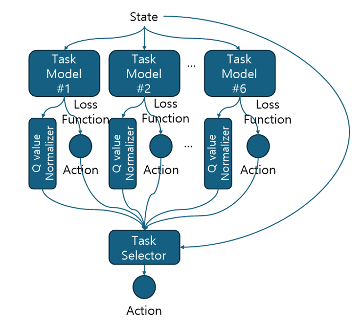

# Multi-Task Reinforcement Learning in NetHack Using MOTIF

A team project exploring multi-task reinforcement learning in NetHack by extending MOTIF with multiple task-specific policies and dynamic task selection.

## Overview

NetHack is a complex reinforcement learning environment that requires an agent to handle multiple objectives such as exploration, survival, resource collection, and dungeon progression.

The original MOTIF framework mainly focuses on learning a policy for a specific task.

The goal of this project was to extend this idea toward multi-task reinforcement learning, allowing an agent to select an appropriate task-specific policy depending on the current environment state.

The central idea was:

> Instead of using a single policy for a single objective, train multiple task-specific policies and dynamically select the most appropriate one according to the current situation.

## NetHack Learning Environment

NetHack is a roguelike game with a highly complex environment.

Important characteristics include:

- Randomly generated dungeons
- A large number of possible actions
- Complex interactions with monsters, items, and the environment
- Permanent death
- Sparse rewards
- Multiple objectives involving survival, exploration, and resource collection

Because of these characteristics, NetHack provides a challenging environment for reinforcement learning and autonomous decision-making.

## MOTIF

MOTIF is a reinforcement learning framework designed to improve agent exploration by introducing intrinsic rewards generated from LLM-based preferences.

The general process is:

1. Collect observations from the environment.
2. Use textual information from NetHack as a representation of the current situation.
3. Use an LLM to estimate preferences between observations.
4. Train a reward model based on those preferences.
5. Convert the learned preference information into intrinsic rewards.
6. Combine intrinsic rewards with environmental rewards.
7. Train the reinforcement learning policy.

MOTIF uses a PPO-based training pipeline built on Sample Factory.

For this project, the main limitation was that each policy primarily focused on a single objective.

## Project Goal

The goal was to develop a **Multi-Task Agent** capable of changing its behavioral priority depending on the situation.

For example, an agent may need to:

- Explore unfamiliar areas
- Search for stairs
- Collect gold
- Find food
- Prioritize survival

The project therefore focused on the following question:

> How can an agent determine which task-specific policy should be prioritized in the current state?

## Task Models

Several task-specific policies were considered.

| Task | Objective |
|---|---|
| **Scout** | Discover new dungeon tiles and explore new areas |
| **Staircase** | Find stairs and progress to the next dungeon level |
| **Gold** | Collect gold and obtain resources |
| **Eat** | Find and consume food to prevent starvation |
| **Pet** | Keep the pet alive while searching for stairs |

Each task represents a different objective that may become important depending on the current situation.

## Multi-Task Architecture

The system consists of multiple task-specific models and a task selector.

Each task model receives the current state and estimates action values for its own objective.  
The outputs are normalized and passed to the task selector, which determines the final action according to the current situation.

<p align="center">
  
</p>

## Task Selection Methods

Several approaches were investigated for combining the task-specific models.

### Random Task Selector

A task model is selected randomly.

This method was implemented as a simple baseline for evaluating more informed task-selection approaches.

### Average Action Distribution Selector

The action distributions produced by the task models are compared or combined.

The resulting information is used to select an action.

This approach allows multiple task-specific policies to contribute to the final decision.

### Value-Based Selectors

The values produced by each task model are compared after normalization.

The purpose was to investigate whether task-model value information could be used to determine which policy should be prioritized.

### MLP-Based Dynamic Task Selector

An MLP-based selector was designed to make task selection dependent on the current environment state.

Instead of using a fixed selection rule, the selector learns a correction ratio for the values produced by the task-specific models.

The corrected values are then used to determine which task model should receive greater priority.

The objective was to allow the agent to dynamically change its behavior according to the current situation.

#### MLP Training

Training data for the MLP selector was collected by running simulations with the individual task models.

The general procedure was:

1. Run simulations using each task-specific model.
2. Collect state and task-model information.
3. Store the collected data during the episode.
4. Train the MLP after the episode ends.
5. Repeat the process over multiple episodes.

The MLP was designed to learn how task priorities should be adjusted according to the current environment state.

## Investigation of Pareto Multi-Task Learning

Pareto Multi-Task Learning was initially investigated as another possible method for balancing multiple objectives.

In NetHack, objectives may conflict with each other.

For example:

- Exploration may increase the risk of death.
- Resource collection may require entering dangerous areas.
- Focusing only on survival may reduce exploration and progression.

Pareto optimization was considered as a possible way to balance these competing objectives.

However, NetHack has a highly complex and nonlinear environment with a large state space and irregular game rules.

Because of this complexity, directly applying Pareto Multi-Task Learning was considered difficult for this project.

The project therefore focused on combining separately trained task policies with explicit task-selection mechanisms.

## Evaluation

The multi-task system was evaluated using multiple aspects of agent behavior rather than relying only on the game score.

Evaluation factors included:

- Game score
- HP / survival state
- Hunger state
- Exploration
- Task-specific performance

A weighted evaluation method was also considered to combine multiple indicators.

For example:

```text
Overall Evaluation
= Score × 0.5
+ HP × 0.3
+ Exploration × 0.2
```

The purpose was to evaluate whether the agent could behave consistently across several different objectives.

## Results

Several task-selection strategies were investigated, including:

- Random task selection
- Action-distribution-based selection
- Value-based selection
- MLP-based dynamic task selection

The experiments showed that the choice of task-selection strategy had a strong influence on overall agent behavior.

The MLP-based dynamic selector was designed to adjust task priorities according to the current environment state.

The project summary reported:

- More stable score collection
- Longer survival
- Clear behavioral differences depending on the task-selection strategy

These observations suggest that **selecting the appropriate task policy is itself an important decision-making problem in multi-task reinforcement learning**.

## My Contributions

This was a team project.

My main contributions were:

- Analysis of the MOTIF and NetHack Learning Environment codebase
- Analysis of Pareto Multi-Task Learning
- Investigation of multi-task reinforcement learning approaches
- Implementation of the Random Task Selector
- Evaluation of selector models
- Analysis of experimental results

## Discussion

This project highlighted an important challenge in multi-task reinforcement learning.

Training multiple specialized policies is not sufficient by itself.

The agent must also determine:

> Which objective should be prioritized in the current situation?

This introduces an additional decision-making layer on top of the individual reinforcement learning policies.

The project also revealed several challenges:

- Different task policies optimize different objectives.
- Values produced by different policies are not always directly comparable.
- Objectives may conflict with each other.
- Fixed task-selection rules cannot adapt to changing situations.
- Dynamic task selection requires an additional learning process.
- Multi-objective learning becomes difficult in complex environments such as NetHack.

The MLP-based selector was explored as one approach for making task priorities state-dependent rather than fixed.

## Key Takeaways

This project provided several insights into multi-task reinforcement learning:

- Different objectives can benefit from specialized policies.
- Task selection is an important decision-making problem.
- Random selection provides a useful baseline but does not use environment information.
- Value information can be used to coordinate multiple task policies.
- Dynamic task selection can make agent behavior more adaptive.
- Competing objectives make multi-task reinforcement learning difficult.
- Policy-selection mechanisms can strongly influence overall agent behavior.

This project also strengthened my interest in **adaptive decision-making**, where an autonomous agent changes its behavior according to the current environment and objectives.

## References

- [NetHack](https://github.com/NetHack/NetHack)
- Küttler, H. et al. *The NetHack Learning Environment*  
  https://arxiv.org/abs/2006.13760
- [MOTIF](https://github.com/facebookresearch/motif)
- *MOTIF: Intrinsic Motivation from Artificial Intelligence Feedback*  
  https://arxiv.org/abs/2310.00166
- Lin, X. et al. *Pareto Multi-Task Learning*. NeurIPS 2019  
  https://proceedings.neurips.cc/paper_files/paper/2019/file/685bfde03eb646c27ed565881917c71c-Paper.pdf
